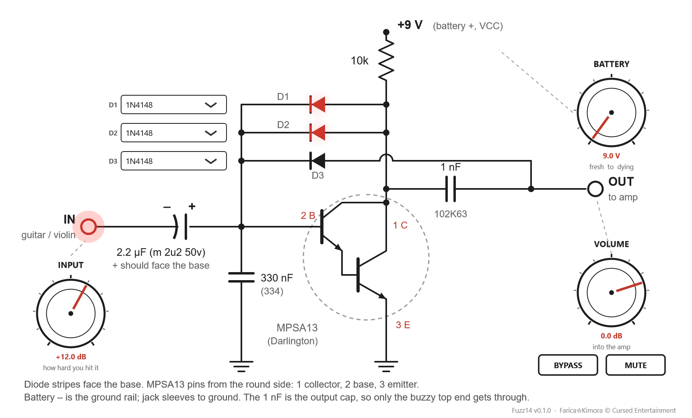

# Fuzz14

A real-time circuit emulation of a fuzz pedal first built on a breadboard in 2014: one MPSA13
Darlington transistor as a common-emitter amp, with 1N4148 diodes in the feedback clipping it
(the Bazz Fuss family, plus the diodes added "till it sounded right").

[Farica☆Kimora](https://github.com/Farica-Kimora) © Cursed Entertainment

A VST3 plugin and standalone app (with ASIO) for Windows, for guitar or electric violin. The
window is the schematic: the knobs sit next to the parts they belong to, and the diodes glow
while they conduct.

**Website:** https://cursedprograms.github.io/Fuzz14/ &middot; **Download:** [latest release](https://github.com/CursedPrograms/Fuzz14/releases/latest)



## Controls
- **INPUT** - how hard the instrument hits the circuit (0 dB: full scale = 1 V at the input jack).
  Like a real one-transistor fuzz it only fuzzes when it's hit hard: a pickup gives 0.1-1 V, a mic
  preamp often only 0.01-0.03 V, so for a voice turn INPUT up to +18 dB or more. The IN jack glows
  red as you drive it.
- **BATTERY** - a fresh 9 V down to a dying 6 V, with the internal resistance climbing as it goes.
- **VOLUME** - what reaches the amp.
- **D1, D2 and D3** - click a diode in the schematic (or use the pickers) to swap it while you
  play, like pulling one out of the breadboard and pushing another in. Mixing kinds gives a more
  dynamic sound: next to a silicon one, a germanium starts conducting first and the silicon takes
  over on the big peaks. D1 and D2 are what bias the transistor, so pull both out and it goes
  (nearly) silent - that's the point. Diodes glow red while they conduct; LEDs show their colour
  and light up when they conduct.
- **BYPASS** - true bypass: the clean signal, lined up with the pedal so switching doesn't jump.
  Your DAW's bypass button is the same switch.
- **MUTE** - silence, for tuning or between songs. (The standalone app opens with the input live:
  no "muted to avoid feedback" bar. Use headphones or keep the mic away from the speakers.)

| Kind | Diodes | Forward voltage (about, at 1 mA) |
|---|---|---|
| Silicon | **1N4148** (the original), 1N914, 1N4001 | 0.57-0.61 V |
| Germanium | 1N34A, OA90, 1N270 | 0.28-0.32 V |
| Schottky | BAT41, BAT85, 1N5817 | 0.20-0.45 V |
| LED | infrared, red, yellow, green, blue, white | 1.1-2.8 V |
| Pulled out | None | - |

The low ones (germanium, Schottky) conduct earlier and squash harder. An LED needs 1.1-2.8 V, so
next to a silicon diode, or in D3, it never gets enough voltage and stays dark, just as it would on
a real breadboard. Put LEDs in both D1 and D2 (or one LED with the other spot pulled out) and they
carry the bias current and light up. The models are fitted to each type's usual forward voltage,
not taken from datasheets, so they're close, not exact.

Defaults are the 2014 board: 1N4148 everywhere, a fresh battery.

## Install
Download the zip from [Releases](https://github.com/CursedPrograms/Fuzz14/releases):
- `Fuzz14.exe` - standalone; pick your audio interface (ASIO) in Options > Audio/MIDI Settings.
- `Fuzz14.vst3` - copy to `C:\Program Files\Common Files\VST3` and rescan in your DAW.

It solves the whole circuit every sample, 2x oversampled at 44.1 / 48 kHz: about 12 % of one
CPU core.

## Build
Needs CMake and Visual Studio 2022 ("Desktop development with C++"). Run `build.bat`; the results
land in `dist\`. JUCE 8 is downloaded the first time. `tools/render.cpp` plays a synthetic guitar
through every diode and renders the window; `tools/draw_schematic.py` draws the schematic (and
the plugin's skin, `Source/skin.svg`).

## The circuit


(PNG version: [images/schematic.png](images/schematic.png))

Wired like this on the board (MPSA13 pins seen from the round side):

| | |
|---|---|
| **VCC** (battery +) | 10k |
| **Pin 1** (collector) | 10k, D1, D2 (plain ends), 102K63 |
| **Output jack** | 102K63, D3 (plain end) |
| **Pin 2** (base) | D1, D2, D3 (stripe ends), 334 (330 nF), 2.2 µF − |
| **Pin 3** (emitter) | 334, ground |
| **Ground** (battery −) | pin 3, jack sleeves |
| **Input jack** | 2.2 µF + |

- **D1 and D2 side by side** from collector to base set the bias: the collector sits one diode
  drop (about 0.1-0.6 V depending on the current) above the base.
- **The 102K63 is the output cap**: 1 nF (10 x 10^2 pF), ±10 % (K), 63 V. Into an amp's 1 MΩ
  input it only passes what's above about 150 Hz, so the low end is gone and what's left buzzes.
- **D3 from the output back to the base** clips the big peaks.
- **The 2.2 µF ("m 2u2 50v": 2.2 µF, ±20 %, 50 V)** is in with its − on the base. The base sits at
  about +1.2 V and the jack at 0 V, so + should face the base. It has survived because 1.2 V of
  reverse voltage is gentle; flip it on a new build.

## The solver
`Source/circuit` is a small modified-nodal-analysis solver (Newton iterations, trapezoidal
capacitors, Shockley diodes, Ebers-Moll transistors) that runs the whole circuit sample by
sample. Against ngspice 47 with the same netlist (`spice/fuzz14.cir`) it matches within
0.24 % of the signal over several levels and pitches.

```
cmake -S . -B build && cmake --build build --config Release
ngspice -b spice/fuzz14.cir          # writes spice_out.csv
build/Release/verify.exe             # writes the solver's output
python tools/compare.py spice_out.csv solver_out.csv
```

## License
MIT, see [LICENSE](LICENSE). It is built with [JUCE](https://juce.com), which is under its own
licence (AGPLv3 or a commercial JUCE licence), and the standalone app uses Steinberg's ASIO
interface bundled with JUCE. Anyone distributing compiled builds must follow those licences too.

---

<br>
<div align="center">
© Cursed Entertainment 2026
</div>
<br>
<div align="center">
<a href="https://cursed-entertainment.itch.io/" target="_blank">
    
</a>
</div>
