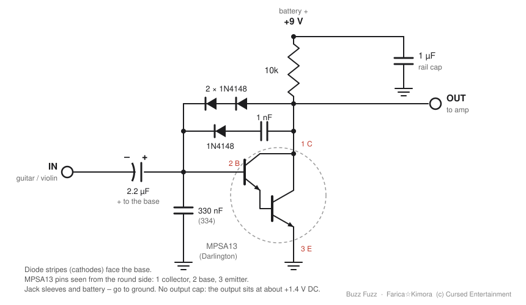

# Buzz Fuzz

A real-time circuit emulation of a fuzz pedal first built on a breadboard in 2014: one MPSA13
Darlington transistor as a common-emitter amp, with 1N4148 diodes in the feedback clipping it
(the Bazz Fuss family, plus the diodes added "till it sounded right" and a 1 µF cap across the
battery that made it louder and steadier).

Farica☆Kimora  (c) Cursed Entertainment

**Status: work in progress.** The circuit solver works; the plugin (VST3 + standalone) is next.
See [TODO.md](TODO.md).

## The circuit


(PNG version: [images/schematic.png](images/schematic.png))

```
                          +9V ──┬────────┐
                                │        ═  + 1µF  rail cap (electrolytic)
                               10k       │  – to pin 3 / GND
                                │        ┴
  OUT jack ─────────────────────┤ collector (pin 1)
                                │
                  ┌──|◄──|◄─────┤   2× 1N4148 in series, stripes toward the base
                  ├──|◄──┤├─────┘   1N4148 + 1nF (grey 102K63)
                  │
  IN jack ── –┤├+ ┴─────────────── base (pin 2)       MPSA13 Darlington
          2.2µF   │                                   pins from the round side
                330nF (blue, 334)                    1 C · 2 B · 3 E
                  │
                 GND ───────────── emitter (pin 3), rail cap –
```
(|◄ = a diode, the bar is the stripe: current flows from the collector into the base)

- The 2.2 µF's **+ leg goes to the base**: the base sits at about +1.2 V, the jack at 0 V.
  (The 2014 build has it the other way round; 1.2 V of reverse voltage is small enough that it
  survived, but a new build should flip it.)
- No output cap: the output sits at about +1.4 V DC, harmless into an amp but it can pop when
  you plug in. A 100 nF-1 µF cap in series with the output jack fixes that.
- The grey 1 nF is marked 102K63: 10 x 10^2 pF = 1000 pF = 1 nF, K = ±10 %, 63 V. The model uses
  exactly 1 nF; a real one can be anywhere from 0.9 to 1.1 nF.
- Jack sleeves and the battery's minus go to ground.

## The solver
`Source/circuit` is a small modified-nodal-analysis solver (Newton iterations, trapezoidal
capacitors, Shockley diodes, Ebers-Moll transistors) that runs the whole circuit sample by
sample. Against ngspice 47 with the same netlist (`spice/buzz_fuzz.cir`) it matches within
0.13 % of the signal over several levels and pitches.

```
cmake -S . -B build && cmake --build build --config Release
ngspice -b spice/buzz_fuzz.cir          # writes spice_out.csv
build/Release/verify.exe                  # writes the solver's output
python tools/compare.py spice_out.csv solver_out.csv
```

## License
MIT, see [LICENSE](LICENSE).
